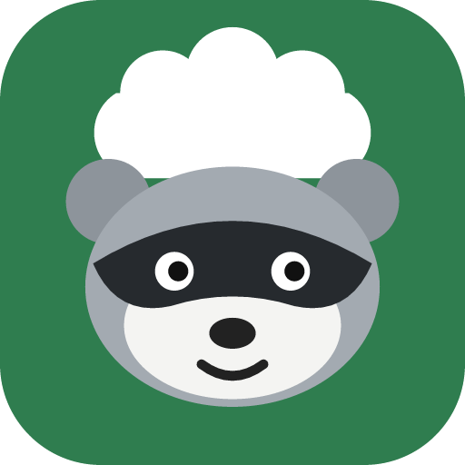

<p align="center"></p>

<h1 align="center">Nighttime Ninja</h1>

<p align="center">A self-hosted, tablet-first kitchen manager. Recipes, pantry, shopping list and meal plan, run by a very organized raccoon.</p>

## What it does

- **Recipes** in one standard format, imported from recipe websites (schema.org), pasted text, files, or **KitchenOwl**. Scale servings, cook mode, and share any recipe with a public link.
- **Ready to cook**: every recipe shows whether your pantry has what it needs. Tap **I cooked this** and the ingredients are taken out of inventory.
- **Pantry inventory** with green photo/icon tiles, low-stock warnings, expiry dates and a full **history** of every change.
- **Shopping list** with quick add (“2 lb chicken, milk, 3 avocados”), suggestions from what you buy most, purchase history, and checked-off items flowing into the pantry.
- **7-day meal plan** that can fill the shopping list for the week and shows up in **Google Calendar** as a subscribed calendar.
- **Homes**: create a home or join one with a code. **Home managers** run members and settings; **server admins** see everyone.
- **Strong sign-in** that's safe to put on the internet: passwords (scrypt), **two-factor codes** with recovery codes, **passkeys**, **Google** (OIDC), invite-only sign-up, rate limiting, a list of signed-in devices you can sign out, and **pairing codes** for tablets. Name-only quick sign-in only works from your home network.
- **US measurements**: metric amounts and °C are shown as cups, ounces, pounds and °F (or switch to metric).
- **Deals**: live prices and sales from the Kroger API, plus one-tap search, weekly ads and coupons for Walmart, Food Lion, Kroger, BJ's, Sam's Club and more.
- **Mixologist**: chat with an AI bartender (Claude) that knows what's in your bar and pantry, an **Idea Zone** that turns a drink style into recipes you can make now (or adds the one or two missing bottles to your list), your saved cocktails, and a bar measurement converter and batch scaler.
- **Feed**: follow cooks' YouTube channels, blogs or any RSS feed and watch new videos in the app.
- **Home Assistant**: token-based API with a summary sensor and a shopping-list service.
- **Themes and raccoons**: six themes and eight raccoon chef avatars.
- **Runs everywhere**: Docker (with an Unraid template), the browser, an Android APK, and a Windows EXE.

## Quick start with Docker

```bash
docker run -d --name nighttime-ninja -p 8080:8080 -v ./data:/data ghcr.io/spacegoose02/nighttime-ninja:latest
```

Open http://localhost:8080. The first person to sign in becomes the server admin.

Or with Compose: copy `.env.example` to `.env`, adjust it, and run `docker compose up -d`.

### Unraid

In the Docker tab choose **Add Container** and set **Template** to this URL, or drop the file into `/boot/config/plugins/dockerMan/templates-user/`:

```
https://raw.githubusercontent.com/Spacegoose02/Nighttime-Ninja/main/unraid/nighttime-ninja.xml
```

## Settings

All settings are environment variables. See [.env.example](.env.example).

| Variable | What it does |
| --- | --- |
| `PUBLIC_URL` | The address people use, e.g. `https://kitchen.example.com`. Needed for Google sign-in and calendar links. |
| `DATA_DIR` | Where the SQLite database and photos live (`/data` in Docker). |
| `GOOGLE_CLIENT_ID`, `GOOGLE_CLIENT_SECRET` | Turn on Google sign-in. See [docs/google-sign-in.md](docs/google-sign-in.md). |
| `SIGNUP_MODE` | `invite` (default, needs a home join code), `open`, or `closed`. Admins can change it in Settings. |
| `LOCAL_LOGIN` | Name-only quick sign-in: `lan` (home network only), `off`, or `anywhere`. |
| `TRUST_PROXY` | Reverse proxies allowed to set X-Forwarded headers. Defaults to loopback and private networks. |
| `SESSION_SECRET` | Optional. Generated and saved in the data folder if empty. |
| `KROGER_CLIENT_ID`, `KROGER_CLIENT_SECRET` | Optional, free from [developer.kroger.com](https://developer.kroger.com). Turns on live prices and sale matching. |
| `ANTHROPIC_API_KEY` | Optional, from [console.anthropic.com](https://console.anthropic.com). Turns on the Mixologist's chat and drink ideas. `ANTHROPIC_MODEL` sets the default Claude model (`claude-opus-5-5`); admins can switch it in **Settings → Server admin**. |
| `AI_MESSAGES_PER_HOUR` | How many AI requests one person can send per hour, so a busy household can't run up the Claude bill. Default `30`; `0` turns the cap off. |
| `ALLOW_PRIVATE_FETCH` | Recipe import and feeds won't fetch links that point into your home network. Set to `true` if you import from your own LAN servers. |

## Putting it on the internet

1. Put it behind a reverse proxy with HTTPS (Nginx Proxy Manager, SWAG, Caddy, Traefik or a Cloudflare Tunnel) and set `PUBLIC_URL` to the https address. Passkeys and Google sign-in need this.
2. Keep `SIGNUP_MODE=invite` so only people with one of your homes' join codes can make accounts.
3. Everyone should set a password and turn on two-factor or add a passkey in **Settings → Sign-in and security**. Quick sign-in keeps working at home but is refused from the internet. (The app tells home from internet by IP address, so always go through the reverse proxy. If you forward a port straight to the container, set `LOCAL_LOGIN=off`.)
4. If someone gets locked out, an admin can hand them a temporary password or clear their two-factor in **Settings → Server admin**.

## Moving from KitchenOwl

Open **Recipes → Import**. Either connect straight to your KitchenOwl server with a long-lived token (Settings → Account in KitchenOwl), or upload the JSON from KitchenOwl's household export. Recipes come over with photos, tags, times and servings; KitchenOwl's item catalog becomes quick-add suggestions; shopping lists land on your list. Recipes you already have are skipped, so you can run it again safely.

## Apps

- **Android (phones and tablets)**: download the APK from [Releases](../../releases). On first launch, enter your server's address. To sign in, open **Settings → Pair a device** on a computer and type the code on the tablet.
- **Windows**: download the installer or portable EXE from [Releases](../../releases). Change servers from the app menu.
- **Any browser**: open your server and use “Add to Home screen” to install it as an app.

Both native apps are thin wrappers around your server's web app (see `apps/launcher`, `apps/desktop` and `web/capacitor.config.ts`), so they always match the server version.

## Home Assistant

See [docs/home-assistant.md](docs/home-assistant.md) for sensors (tonight's dinner, shopping count, low stock) and a service to add things to the shopping list.

## Development

Requires Node.js 24 or newer.

```bash
npm install
npm run dev:server   # API on http://localhost:8080
npm run dev:web      # app on http://localhost:5173 (proxies /api)
npm test
npm run typecheck
```

| Folder | What's in it |
| --- | --- |
| `server/` | Fastify API using Node's built-in SQLite. TypeScript runs directly on Node 24, no build step. |
| `web/` | React + Vite app, plus the Capacitor Android config. |
| `shared/` | Unit conversion, the standard recipe format and importers, item icons. Used by both. |
| `apps/launcher/` | The “pick your server” page used by the Android and Windows apps. |
| `apps/desktop/` | Electron wrapper for the Windows EXE. |
| `unraid/` | Unraid Community Applications template. |

Building the apps yourself:

```bash
npm run dist --workspace apps/desktop          # Windows installer + portable EXE in apps/desktop/release
cd web && npx cap add android && npx cap open android   # then Build → Build APK in Android Studio
```

Tagging a release (`git tag v0.1.0 && git push --tags`) builds the Docker image, the EXE and the APK in GitHub Actions.

To publish a signed Android release instead of a debug build, add four repository secrets: `ANDROID_KEYSTORE_BASE64` (your `.jks` file, base64-encoded), `ANDROID_KEYSTORE_PASSWORD`, `ANDROID_KEY_ALIAS` and `ANDROID_KEY_PASSWORD`. Keep the keystore safe: every future update has to be signed with the same key. Phones that installed an older debug-signed APK need to uninstall it once before installing the signed one.

## Privacy

Everything stays on your server. Store and feed lookups go straight from your server to those sites. If you turn on the Mixologist, your bar and pantry item names and your chat messages are sent to the Claude API to answer you. Tokens for KitchenOwl imports are used once and never saved.

## License

MIT
