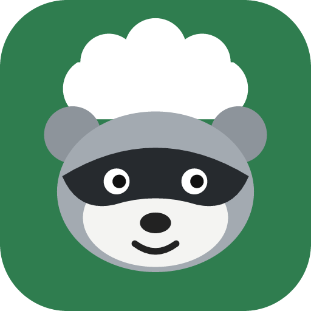
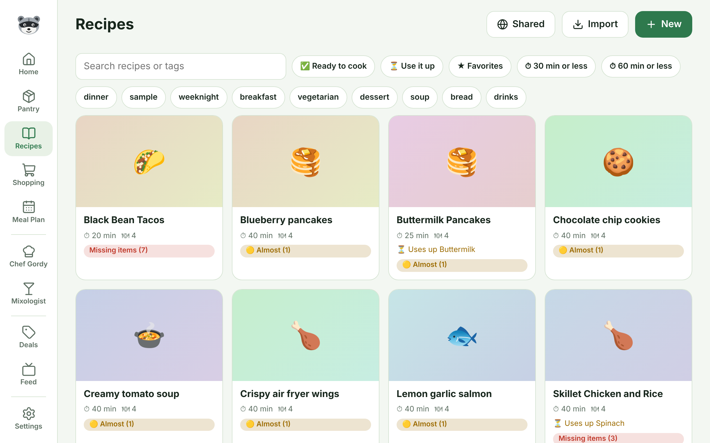
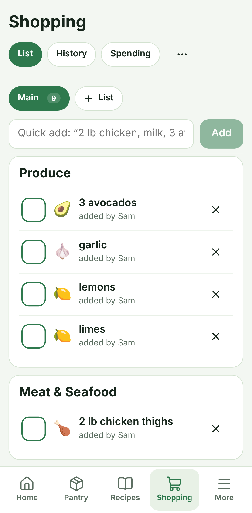

<!-- Built from README.md; keep the two in step. -->

<p align="center"></p>

<h1 align="center">Nighttime Ninja</h1>

<p align="center">A self-hosted, tablet-first kitchen manager. Recipes, pantry, shopping lists and meal plan, run by a very organized raccoon.</p>

<p align="center">
  <a href="#quick-start-with-docker">Quick start</a> ·
  <a href="settings.md">Settings</a> ·
  <a href="apps.md">Apps</a> ·
  <a href="https://github.com/Spacegoose02/Nighttime-Ninja/blob/main/CONTRIBUTING.md">Contributing</a> ·
  <a href="https://github.com/Spacegoose02/Nighttime-Ninja/blob/main/CHANGELOG.md">Changelog</a>
</p>

<p align="center">
  
  
</p>

## What it does

- **Recipes** in one standard format, imported from recipe websites (schema.org), pasted text, files, or **KitchenOwl**. Scale servings, cook mode, and share any recipe with a public link.
- **Ready to cook**: every recipe shows whether your pantry has what it needs. Tap **I cooked this** and the ingredients are taken out of inventory.
- **Kitchen tools**: tick off the gear you own (air fryer, stand mixer, cocktail shaker and so on). Recipes that need something you don't have get a 🍳 note, the recipe list can show only what you can make, and Gordy and Rocco cook around what you've got.
- **Pantry inventory** with green photo/icon tiles, low-stock warnings, expiry dates and a full **history** of every change.
- **Shopping lists**: Main plus as many as you like (a quick trip, long-term buys), with items you can move between them. Quick add (“2 lb chicken, milk, 3 avocados”), suggestions from what you buy most, purchase history, and checked-off items flowing into the pantry.
- **7-day meal plan** that can fill the shopping list for the week and shows up in **Google Calendar** as a subscribed calendar.
- **Homes**: create a home or join one with a code. **Home managers** run members and settings; **server admins** see everyone.
- **Strong sign-in** that's safe to put on the internet: passwords (scrypt), **two-factor codes** with recovery codes, **passkeys**, **Google** (OIDC), invite-only sign-up, rate limiting, a list of signed-in devices you can sign out, and **pairing codes** for tablets. Name-only quick sign-in only works from your home network.
- **US measurements**: metric amounts and °C are shown as cups, ounces, pounds and °F (or switch to metric).
- **Deals**: live prices and sales from the Kroger API, plus one-tap search, weekly ads and coupons for Walmart, Food Lion, Kroger, BJ's, Sam's Club and more.
- **Chef Gordy**: an AI cook (Claude) that plans your week from what you have, answers cooking questions with web sources, and saves recipes when you ask.
- **Mixologist**: chat with an AI bartender (Claude) that knows what's in your bar and pantry, an **Idea Zone** that turns a drink style into recipes you can make now (or adds the one or two missing bottles to your list), your saved cocktails, and a bar measurement converter and batch scaler.
- **Feed**: follow cooks' YouTube channels, blogs or any RSS feed and watch new videos in the app.
- **Home Assistant**: token-based API with a summary sensor and a shopping-list service.
- **Themes and raccoons**: six themes and eight raccoon chef avatars.
- **Live and offline**: changes show up on every screen in the home right away, and the shopping list keeps working with no signal in the store (it syncs when you're back). Install it from the browser like an app. Offline use needs https, which browsers require for it.
- **Runs everywhere**: Docker (with an Unraid template), the browser, an Android APK, and a Windows EXE.

## What needs an extra key

Everything works with no outside accounts. A few extras switch on when you add a key:

| Feature | Needs |
| --- | --- |
| Recipes, pantry, shopping lists, meal plan, kitchen tools, cook mode, live sync, offline list, reminders | Nothing |
| Chef Gordy, Mixologist chat and Idea Zone, Plan my week, recipe from photos or videos, nutrition, receipt scanning | `ANTHROPIC_API_KEY` |
| Live Kroger prices and sale matching | `KROGER_CLIENT_ID` and `KROGER_CLIENT_SECRET` |
| Google sign-in, calendar links | `GOOGLE_CLIENT_ID`, `GOOGLE_CLIENT_SECRET` and `PUBLIC_URL` |
| Barcode product details | Nothing (uses Open Food Facts) |

## Quick start with Docker

```bash
docker run -d --name nighttime-ninja -p 8080:8080 -v ./data:/data ghcr.io/spacegoose02/nighttime-ninja:latest
```

Open http://localhost:8080. The first person to sign in becomes the server admin.

Or with Compose: copy `.env.example` to `.env`, adjust it, and run `docker compose up -d`.

### Unraid

In the Docker tab choose **Add Container** and set **Template** to this URL, or drop the file into `/boot/config/plugins/dockerMan/templates-user/`:

```
https://raw.githubusercontent.com/Spacegoose02/Nighttime-Ninja/main/unraid/nighttime-ninja.xml
```

All settings are environment variables. The full list, and how to put the app safely on the internet, is in [docs/settings.md](settings.md).

## Backups

The server backs up its database every night and before every upgrade, into `backups/` in the data folder. Download them from **Settings → Server admin**. See [docs/settings.md](settings.md#backups) for restoring.

## More

- [Settings and putting it on the internet](settings.md)
- [Android and Windows apps](apps.md)
- [Moving from KitchenOwl](kitchenowl.md)
- [Home Assistant](home-assistant.md)
- [Google sign-in](google-sign-in.md)
- [Development](development.md) and [Contributing](https://github.com/Spacegoose02/Nighttime-Ninja/blob/main/CONTRIBUTING.md)

## Privacy

Everything stays on your server. Store and feed lookups go straight from your server to those sites. If you turn on the Mixologist, your bar and pantry item names and your chat messages are sent to the Claude API to answer you. When web search is on, Claude may run web searches on what you ask about; the searches run on Anthropic's side, not from your server. Tokens for KitchenOwl imports are used once and never saved.

## License

MIT
